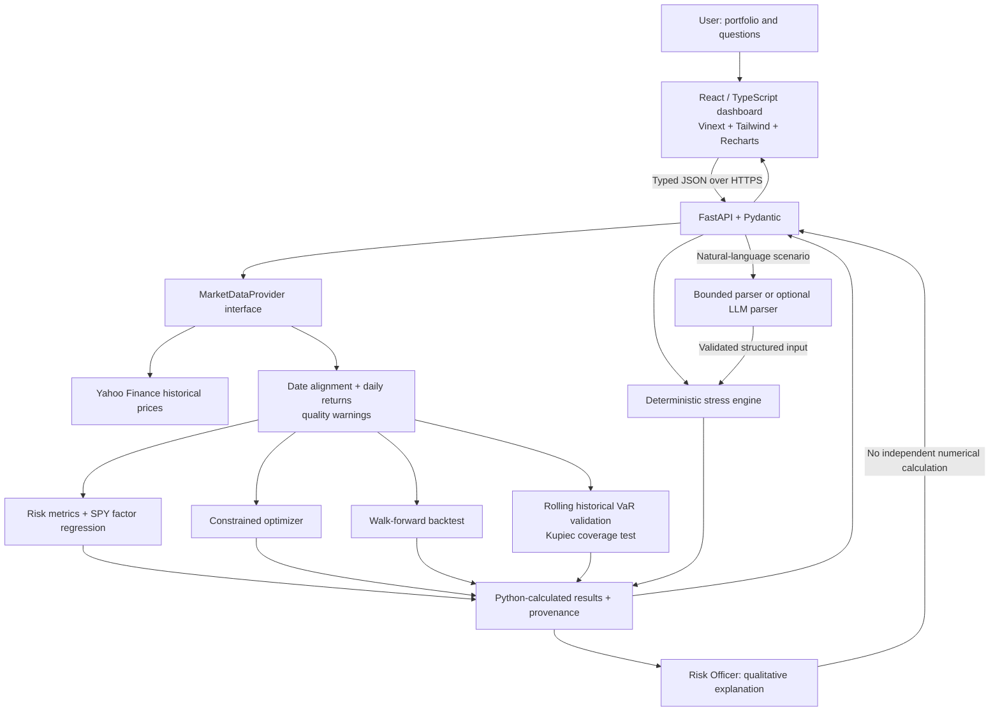
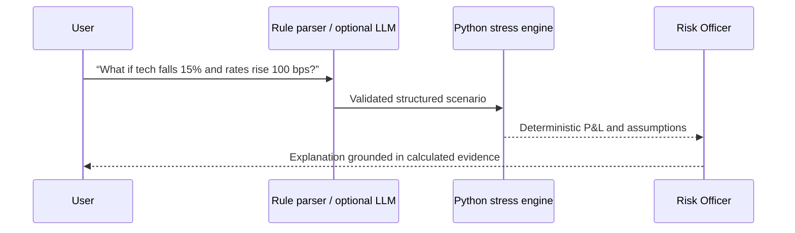
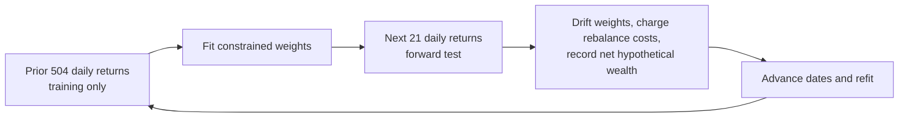

# RiskLens — AI Portfolio Risk Terminal

[](https://github.com/TianLu-hub/RiskLens/actions/workflows/ci.yml)

**English** · [简体中文](README.zh-CN.md)

[Live dashboard](https://risklens-ai-portfolio-risk-terminal.tianlu923.chatgpt.site/) · [API health](https://balanced-intuition-production-6020.up.railway.app/health)

RiskLens is a full-stack, desktop-first risk dashboard for stock and ETF portfolios. Enter tickers and weights to inspect historical risk, run explicitly hypothetical shocks, compare constrained allocations, and evaluate them with a chronological walk-forward backtest. This is an educational quantitative-finance project, not a trading system or personalized financial advice.

> **Numerical boundary:** Deterministic Python code produces every financial metric and scenario P&L. The default “AI Risk Officer” is a zero-cost rule-based interpretation layer. An optional server-side LLM may parse language and explain *supplied* results, but never invents or independently calculates numbers.

## Features

The header's **EN / 中文** control switches the interface between English and Simplified Chinese and remembers your choice in this browser. It does not reset inputs or change numerical results. Unmapped backend prose remains in its original language; monetary values remain USD.

Click the ⓘ beside a metric to read its definition, formula, interpretation, and limitations in the selected language. Help covers nine metrics, including VaR, CVaR, SPY beta, and volatility risk contributions. The explanations document the Python implementation and make no AI requests.

| Area | Implemented capability |
| --- | --- |
| Risk overview | Geometric return, volatility, Sharpe estimate, historical one-day VaR/CVaR, drawdown, correlation, Euler risk contribution, concentration, and rule-based flags. |
| Stress testing | Market, technology, interest-rate, and ticker shocks; simplified historical-style presets; asset/factor P&L attribution with disclosed fallback assumptions. |
| Risk Officer | Bounded English/Chinese scenario parsing and evidence-grounded explanations; optional OpenAI Structured Outputs mode is off by default. |
| Factor exposure | Historical regression against SPY: beta, alpha, R², residual volatility, and rolling 60-day beta. SMB/HML are not fabricated. |
| Optimization | Long-only minimum volatility, maximum Sharpe, and risk parity with optional position caps. Results never change holdings automatically. |
| Walk-forward test | Refit on trailing data and evaluate only on later dates; model weight drift, monthly rebalancing, configurable costs, and a fixed-weight baseline. |
| VaR validation | Rolling one-day historical VaR forecasts, breach audit, and Kupiec unconditional coverage test with bilingual interpretation and small-sample warnings. |

Default portfolio: **AAPL 20% · MSFT 20% · NVDA 15% · SPY 25% · TLT 20%**.

Portfolio edits, lookback, and risk-free rate are saved in this browser and restored on refresh. Results are not saved: click **Analyze portfolio** to load historical data. Changed inputs are flagged until a matching analysis completes; the Risk Officer asks for an updated analysis before interpreting the new portfolio. Storage is device/browser-specific, and analysis still works when browser storage is unavailable.

## Architecture



The language-to-stress path has a strict computation boundary:



### Walk-forward design



Each fold's training period ends **before** its test period begins. The default request covers about three years of Yahoo Finance history: roughly two trading years for the first training window and roughly one year for forward evaluation. The provider caches requests for 15 minutes and reports the actual aligned date range and observation count. This is historical daily data, **not real-time exchange data**.

**Illustrative result, not a performance claim:** On the default portfolio with data available on 2026-10-14, the minimum-volatility walk-forward test covered 2025-10-10–2026-10-13 (253 forward trading days, 13 windows). With 10 bps modeled trading costs, the optimized strategy's simulated cumulative return was **−0.94%**, versus **+14.06%** for the fixed-current-weight baseline. The result is deliberately reported even though the optimizer underperformed; it changes with data, inputs, and assumptions.

### Rolling historical VaR validation

For each test day `t`, use exactly the preceding `window_days` aligned portfolio returns, the slice `[t − window_days:t]`, to estimate one-day `VaR_t = −quantile(returns, 1 − confidence_level)` with linear interpolation. The training window ends before `t`; neither that day's return nor any later return enters its forecast. A breach occurs only when `−r_p,t > VaR_t`. Equality is not a breach, and negative VaR thresholds are retained rather than clamped to zero. The current portfolio weights remain fixed, modeling daily rebalancing without transaction costs. This is a hypothetical historical validation, not actual trading or a guarantee of future risk coverage.

The default window is 252 daily returns (allowed range: 60–1260), and at least 20 subsequent out-of-sample returns are required. `data_quality.observations`, `start_date`, and `end_date` describe the whole aligned return sample, including training; `test_observations`, `test_start`, and `test_end` describe only the evaluated forecast days. Each series point includes its training dates, signed VaR threshold, realized return/loss, and breach flag. Provider provenance is passed through unchanged.

The nominal expected breach rate is `1 − confidence_level`; the expected count is that rate times the number of test observations. Warnings identify fewer than 252 test days or an expected count below 5. Small samples, limited tail resolution, overlapping training windows, and dependent returns restrict interpretation.

#### Kupiec unconditional coverage test

The Python backend tests whether the observed breach frequency is consistent with the nominal rate. For `N` forecast days, `x` breaches, `p0 = 1 − confidence_level`, and `p_hat = x/N`:

```text
logL(p) = x × log(p) + (N − x) × log(1 − p)
LR = 2 × [logL(p_hat) − logL(p0)]
p_value = chi-square survival function(LR, degrees of freedom = 1)
```

Zero-count log terms are defined as zero, so zero breaches and all breaches yield finite statistics. The fixed significance level is **5%**, separate from the selected VaR confidence level. Reject the coverage null when the unrounded `p_value < 0.05`; otherwise report **do not reject**, never “model passed” or “safe.” Rejection can reflect too few or too many breaches. The UI displays the backend's decision without recalculating it.

This is an asymptotic likelihood-ratio test based on an independent Bernoulli breach model with a constant probability. Expected breach/non-breach counts below five and boundary counts trigger additional warnings. It does not test breach clustering, independence, or the size of tail losses; dependent returns and overlapping rolling estimates can weaken its calibration. Non-rejection is not proof of correct risk coverage. See the [Kupiec POF definition and endpoint formulas](https://www.mathworks.com/help/risk/varbacktest.pof.html) and [coverage versus independence tests](https://www.mathworks.com/help/risk/overview-of-var-backtesting.html).

## Quantitative definitions

For aligned daily asset returns `r_t`, weights `w`, and annualized covariance `Sigma_ann = 252 × Cov(r)`:

| Measure | Definition |
| --- | --- |
| Portfolio return | `r_p,t = wᵀ r_t` |
| Geometric annualized return | `R_ann = [product over t of (1 + r_p,t)]^(252/T) − 1` |
| Annualized volatility | `sigma_p = sqrt(wᵀ Sigma_ann w)` |
| Sharpe estimate | `(R_ann − R_f) / sigma_p` |
| Historical 95% one-day VaR / CVaR | Negative fifth-percentile return / negative mean return below that threshold, reported in loss terms; negative values are retained. |
| Maximum drawdown | Minimum of `V_t / max(V_s for s ≤ t) − 1`, including initial wealth in the high-water mark. |
| Volatility-risk share | `w_i (Sigma_ann w)_i / (wᵀ Sigma_ann w)`; shares sum to approximately one. |
| Effective positions | `1 / sum_i(w_i²)` |
| Bond rate shock | First-order `ΔP/P ≈ −D × Δy`, using explicitly labeled fallback durations. |
| One-way turnover | `0.5 × sum_i(abs(w_i,new − w_i,pretrade))`; modeled cost uses twice this traded notional. |

Optimization uses SciPy SLSQP with `sum_i(w_i) = 1`, `w_i ≥ 0`, and optional `w_i ≤ w_max`. Maximum Sharpe uses the same geometric-return estimate displayed in the UI; risk parity targets equal percentage volatility-risk shares. Nonlinear objectives use multiple fixed starts and are not guaranteed global optima.

## Repository structure

```text
backend/
  app/api/             Analysis, stress, officer, optimization, backtest, VaR validation routes
  app/models/          Pydantic contracts
  app/data/            Replaceable Yahoo Finance provider
  app/risk/            Deterministic risk, factor, stress, and rolling VaR validation modules
  app/optimization/    Optimizer and walk-forward simulation
  app/ai/              Bounded parser and optional LLM adapter
  tests/               Synthetic-fixture unit and API tests
frontend/
  app/                 Application entry and theme
  components/          Dashboard panels and reusable UI
  lib/                 Typed API client and labeled demo snapshot
docs/                   Resume bullets and project paper
docker-compose.yml
```

## Run locally

Requires Python 3.12+, Node.js 22.13+, and pnpm. Run the services in separate terminals from the repository root.

**Terminal 1 — FastAPI**

```bash
cd backend
python3 -m venv .venv
source .venv/bin/activate
pip install -r requirements.txt
cp .env.example .env
uvicorn app.main:app --host 127.0.0.1 --port 8000 --reload --env-file .env
```

**Terminal 2 — frontend**

```bash
cd frontend
cp .env.example .env.development.local
pnpm install
pnpm dev
```

Open `http://localhost:3000`. Health: `http://127.0.0.1:8000/health`; interactive API docs: `http://127.0.0.1:8000/docs`. The local frontend targets `http://localhost:8000`. No OpenAI key is required in the default deterministic mode. When the API is unavailable, preloaded analytics remain explicitly labeled as a synthetic demo snapshot.

Alternatively, run `docker compose up --build` at the repository root; the frontend and API use ports 3000 and 8000.

## API overview

| Endpoint | Purpose |
| --- | --- |
| `POST /portfolio/analyze` | Historical risk and data quality. |
| `POST /portfolio/stress-test` | Hypothetical shocks and P&L attribution. |
| `POST /portfolio/optimize` | In-sample allocation comparison. |
| `POST /portfolio/backtest` | Chronological walk-forward comparison. |
| `POST /portfolio/var-backtest` | Rolling one-day historical VaR validation and Kupiec unconditional coverage test. |
| `POST /ai/risk-officer` | Risk interpretation or scenario translation. |
| `GET /market/history/{ticker}` | Normalized price history. |
| `GET /health` | Service liveness and version. |

Example `/portfolio/backtest` request:

```json
{
  "positions": [
    {"ticker": "AAPL", "weight": 0.20},
    {"ticker": "MSFT", "weight": 0.20},
    {"ticker": "NVDA", "weight": 0.15},
    {"ticker": "SPY", "weight": 0.25},
    {"ticker": "TLT", "weight": 0.20}
  ],
  "lookback_years": 3,
  "risk_free_rate": 0.04,
  "objective": "minimum_volatility",
  "max_position_weight": null,
  "training_days": 504,
  "rebalance_days": 21,
  "cost_bps": 10
}
```

Example `/portfolio/var-backtest` request:

```json
{
  "positions": [{"ticker": "SPY", "weight": 1.0}],
  "lookback_years": 3,
  "window_days": 252,
  "confidence_level": 0.95
}
```

This request uses the same portfolio input validation as `/portfolio/analyze`. The inherited `risk_free_rate` input is accepted but unused: historical VaR uses raw portfolio returns.

The response includes `kupiec_test`: the likelihood-ratio `statistic`, `p_value`, `degrees_of_freedom`, fixed `significance_level`, authoritative `reject_null` decision, nominal/observed breach probabilities, sample/breach counts, and `warning_codes`. These values use the same out-of-sample breach flags as the chart and audit table. An older backend without this field shows an unavailable test in the UI, not a fabricated result.

The frontend is deployed as an OpenAI Site and the FastAPI backend on Railway. For another deployment, set frontend `NEXT_PUBLIC_API_URL` to the backend's **public HTTPS origin**, never localhost; set backend `CORS_ORIGINS` to the exact frontend origin. Keep any optional `OPENAI_API_KEY` on the backend only. Saved accounts and portfolios are not part of this release.

### Check a deployment

On GitHub, open **Actions → Production API check → Run workflow**, select `main`, and run the check. The default checks the published API's health, CORS, and hypothetical stress response. The two optional checkboxes independently enable historical analysis and rolling VaR/Kupiec; both are off by default to avoid unnecessary Yahoo requests. Results appear in the run summary, including failures. This is manual only, requires no API secrets, and does not deploy code. A green result does **not** prove that the latest GitHub commit is running on Railway.

With backend dependencies installed, run this from `backend/`:

To check a specific release, set backend `RISKLENS_REVISION` to the **full 40-character SHA of the source actually deployed**, then redeploy/restart that backend. `/health` reports it as `revision`; unset or invalid values return `null` without exposing arbitrary environment text. Add `--expected-revision FULL_COMMIT_SHA` to the command below, or fill **expected_revision** in the manual workflow. A missing or mismatched revision fails before stress or market-data requests; leaving it blank keeps the original liveness checks. This is an exact comparison of operator-supplied metadata, not proof of artifact authenticity: never change only the variable to make an old deployment appear current.

```bash
# Local API and browser origin; no Yahoo or LLM calls
python -m scripts.check_deployment

# Published API, including historical analysis and rolling VaR/Kupiec validation
python -m scripts.check_deployment \
  --api-url https://balanced-intuition-production-6020.up.railway.app \
  --origin https://risklens-ai-portfolio-risk-terminal.tianlu923.chatgpt.site \
  --include-market-data --include-var-backtest --timeout 60
```

The check verifies the RiskLens health response, browser CORS preflight, actual-response CORS headers, and a typed hypothetical stress response. `--include-market-data` also submits the default portfolio to `/portfolio/analyze`; it may use cached history or fetch Yahoo data. No AI endpoint is called, no portfolio is saved, and no deployment settings are changed.

`--include-var-backtest` independently checks `/portfolio/var-backtest`, including that route's preflight and response CORS headers. It requests the default portfolio with three years of history, a 252-day training window, and 95% VaR. It verifies the Kupiec response contract, reconciles sample sizes and breach summaries with daily records, checks training chronology and signed losses, and confirms the reported decision matches the unrounded p-value. A missing Kupiec field (for example, an older backend) fails the check. A valid **rejection** of the coverage null does not fail deployment. This option may fetch Yahoo history; neither history option runs unless explicitly selected. The check does not recompute VaR quantiles or the Kupiec likelihood ratio.

Exit code `0` means the requested checks passed; `1` identifies a failed check; `2` means invalid command arguments. A connection failure points to the API URL, TLS, timeout, or service availability. CORS failures point to backend `CORS_ORIGINS`. Analysis or VaR requests can return `503` when the data provider is unavailable even if `/health` passes; a VaR `422` can mean insufficient aligned history. Redirects and HTML login pages do not count as a healthy API. This is a connectivity/response-consistency check, not an independent numerical audit, freshness guarantee, or browser UI test.

## Data provenance

Market-history caching is process-local: a 15-minute TTL and a default cap of 128 portfolio/date-range entries. Requests remove expired entries; when full, the least recently used entry is evicted. Cache hits do not extend the original expiry. The entry cap limits retained snapshots, not total process memory or concurrent downloads.

The bilingual data panel distinguishes historical daily prices, synthetic demo data, and hypothetical model results. Analysis, optimization, allocation backtest, and VaR validation responses include optional `data_quality.provenance`: provider fetch time (UTC), cache hit/TTL, price basis, aligned price dates, and per-asset coverage. A cache hit retains the original fetch time; it is not a new quote. Legacy providers without metadata show “Not reported”, never a fabricated timestamp.

The actual sample count is daily **returns**, not price rows or the requested number of years. Backtest metadata includes both training and test data; the forward-test panel separately reports test days. Missingness counts use provider-returned dates, not a full exchange-calendar audit. Up to three missing rows are forward-filled, remaining incomplete dates are excluded, and the retained fill count and each asset's last observed date are disclosed. Calculations and existing alignment rules are unchanged.

Yahoo price validation distinguishes missing observations from invalid values. Zero, negative, infinite, nonnumeric, boolean, or complex closing prices are rejected before alignment and caching; affected APIs return `503` instead of computing from corrupt data. Missing observations still follow the disclosed gap-handling policy. This check does not detect every bad quote or verify prices against another provider.

## Tests

```bash
cd backend
.venv/bin/pytest -q
.venv/bin/ruff check app scripts tests

cd ../frontend
pnpm lint
pnpm test
pnpm build
```

Tests use deterministic synthetic price fixtures, with no Yahoo Finance or LLM dependency. Deployment-check tests also use an in-process API and mocked transport. See the CI run for current results; use the opt-in deployment check above to verify live market access separately.

## Limitations and next research steps

- Historical VaR/CVaR, beta, and fitted weights describe a selected sample; none predicts future losses or returns.
- The optimization panel is in-sample; the separate walk-forward panel is a chronological **hypothetical** simulation, not a record of executed trades. Selecting today's tickers may embed hindsight.
- Modeled close execution and flat basis-point costs omit spreads, slippage, market impact, taxes, and survivorship-bias correction.
- Historical-style stress presets are simplified linear shocks, not exact event replays. Tech exposures and bond durations are disclosed fallback assumptions, not real-time holdings or measurements.
- SPY is the only implemented market-factor proxy; SMB, HML, and momentum remain unavailable until validated factor data is integrated.
- Yahoo Finance data can be delayed, revised, incomplete, or unavailable. The provider aligns dates, warns about gaps, and discloses when unadjusted closes replace adjusted closes.
- Next: test execution-delay/slippage sensitivity, additional validated factors, and robustness across training windows and market regimes. Add persistence only if saved portfolios become necessary.

**For education and research only. Not personalized financial advice.**
