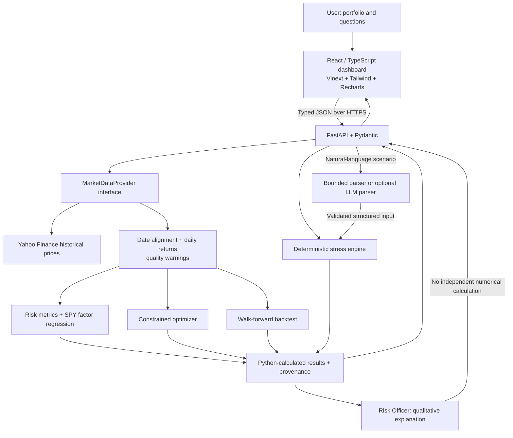
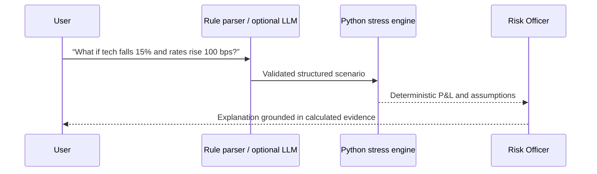
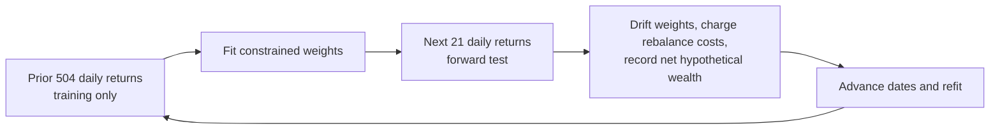

# RiskLens — AI Portfolio Risk Terminal

[](https://github.com/TianLu-hub/RiskLens/actions/workflows/ci.yml)

**English** · [简体中文](README.zh-CN.md)

[Live dashboard](https://risklens-ai-portfolio-risk-terminal.tianlu923.chatgpt.site/) · [API health](https://balanced-intuition-production-6020.up.railway.app/health)

RiskLens is a full-stack, desktop-first risk dashboard for stock and ETF portfolios. Enter tickers and weights to inspect historical risk, run explicitly hypothetical shocks, compare constrained allocations, and evaluate them with a chronological walk-forward backtest. This is an educational quantitative-finance project, not a trading system or personalized financial advice.

> **Numerical boundary:** Deterministic Python code produces every financial metric and scenario P&L. The default “AI Risk Officer” is a zero-cost rule-based interpretation layer. An optional server-side LLM may parse language and explain *supplied* results, but never invents or independently calculates numbers.

## Features

The header's **EN / 中文** control switches the interface between English and Simplified Chinese and remembers your choice in this browser. It does not reset inputs or change numerical results. Unmapped backend prose remains in its original language; monetary values remain USD.

Click the ⓘ beside a metric to read its definition, formula, interpretation, and limitations in the selected language. Help covers nine metrics, including VaR, CVaR, SPY beta, and volatility risk contributions. The explanations document the Python implementation and make no AI requests.

| Area | Implemented capability |
| --- | --- |
| Risk overview | Geometric return, volatility, Sharpe estimate, historical one-day VaR/CVaR, drawdown, correlation, Euler risk contribution, concentration, and rule-based flags. |
| Stress testing | Market, technology, interest-rate, and ticker shocks; simplified historical-style presets; asset/factor P&L attribution with disclosed fallback assumptions. |
| Risk Officer | Bounded English/Chinese scenario parsing and evidence-grounded explanations; optional OpenAI Structured Outputs mode is off by default. |
| Factor exposure | Historical regression against SPY: beta, alpha, R², residual volatility, and rolling 60-day beta. SMB/HML are not fabricated. |
| Optimization | Long-only minimum volatility, maximum Sharpe, and risk parity with optional position caps. Results never change holdings automatically. |
| Walk-forward test | Refit on trailing data and evaluate only on later dates; model weight drift, monthly rebalancing, configurable costs, and a fixed-weight baseline. |

Default portfolio: **AAPL 20% · MSFT 20% · NVDA 15% · SPY 25% · TLT 20%**.

Portfolio edits, lookback, and risk-free rate are saved in this browser and restored on refresh. Results are not saved: click **Analyze portfolio** to load historical data. Changed inputs are flagged until a matching analysis completes; the Risk Officer asks for an updated analysis before interpreting the new portfolio. Storage is device/browser-specific, and analysis still works when browser storage is unavailable.

## Architecture



The language-to-stress path has a strict computation boundary:



### Walk-forward design



Each fold's training period ends **before** its test period begins. The default request covers about three years of Yahoo Finance history: roughly two trading years for the first training window and roughly one year for forward evaluation. The provider caches requests for 15 minutes and reports the actual aligned date range and observation count. This is historical daily data, **not real-time exchange data**.

**Illustrative result, not a performance claim:** On the default portfolio with data available on 2026-10-14, the minimum-volatility walk-forward test covered 2025-10-10–2026-10-13 (253 forward trading days, 13 windows). With 10 bps modeled trading costs, the optimized strategy's simulated cumulative return was **−0.94%**, versus **+14.06%** for the fixed-current-weight baseline. The result is deliberately reported even though the optimizer underperformed; it changes with data, inputs, and assumptions.

## Quantitative definitions

For aligned daily asset returns `r_t`, weights `w`, and annualized covariance `Sigma_ann = 252 × Cov(r)`:

| Measure | Definition |
| --- | --- |
| Portfolio return | `r_p,t = wᵀ r_t` |
| Geometric annualized return | `R_ann = [product over t of (1 + r_p,t)]^(252/T) − 1` |
| Annualized volatility | `sigma_p = sqrt(wᵀ Sigma_ann w)` |
| Sharpe estimate | `(R_ann − R_f) / sigma_p` |
| Historical 95% one-day VaR / CVaR | Negative fifth-percentile return / negative mean return below that threshold, displayed as loss magnitudes. |
| Maximum drawdown | Minimum of `V_t / max(V_s for s ≤ t) − 1`, including initial wealth in the high-water mark. |
| Volatility-risk share | `w_i (Sigma_ann w)_i / (wᵀ Sigma_ann w)`; shares sum to approximately one. |
| Effective positions | `1 / sum_i(w_i²)` |
| Bond rate shock | First-order `ΔP/P ≈ −D × Δy`, using explicitly labeled fallback durations. |
| One-way turnover | `0.5 × sum_i(abs(w_i,new − w_i,pretrade))`; modeled cost uses twice this traded notional. |

Optimization uses SciPy SLSQP with `sum_i(w_i) = 1`, `w_i ≥ 0`, and optional `w_i ≤ w_max`. Maximum Sharpe uses the same geometric-return estimate displayed in the UI; risk parity targets equal percentage volatility-risk shares. Nonlinear objectives use multiple fixed starts and are not guaranteed global optima.

## Repository structure

```text
backend/
  app/api/             Analysis, stress, officer, optimization, backtest routes
  app/models/          Pydantic contracts
  app/data/            Replaceable Yahoo Finance provider
  app/risk/            Deterministic risk, factor, and stress modules
  app/optimization/    Optimizer and walk-forward simulation
  app/ai/              Bounded parser and optional LLM adapter
  tests/               Synthetic-fixture unit and API tests
frontend/
  app/                 Application entry and theme
  components/          Dashboard panels and reusable UI
  lib/                 Typed API client and labeled demo snapshot
docs/                   Resume bullets and project paper
docker-compose.yml
```

## Run locally

Requires Python 3.12+, Node.js 22.13+, and pnpm. Run the services in separate terminals from the repository root.

**Terminal 1 — FastAPI**

```bash
cd backend
python3 -m venv .venv
source .venv/bin/activate
pip install -r requirements.txt
cp .env.example .env
uvicorn app.main:app --host 127.0.0.1 --port 8000 --reload --env-file .env
```

**Terminal 2 — frontend**

```bash
cd frontend
cp .env.example .env.development.local
pnpm install
pnpm dev
```

Open `http://localhost:3000`. Health: `http://127.0.0.1:8000/health`; interactive API docs: `http://127.0.0.1:8000/docs`. The local frontend targets `http://localhost:8000`. No OpenAI key is required in the default deterministic mode. When the API is unavailable, preloaded analytics remain explicitly labeled as a synthetic demo snapshot.

Alternatively, run `docker compose up --build` at the repository root; the frontend and API use ports 3000 and 8000.

## API overview

| Endpoint | Purpose |
| --- | --- |
| `POST /portfolio/analyze` | Historical risk and data quality. |
| `POST /portfolio/stress-test` | Hypothetical shocks and P&L attribution. |
| `POST /portfolio/optimize` | In-sample allocation comparison. |
| `POST /portfolio/backtest` | Chronological walk-forward comparison. |
| `POST /ai/risk-officer` | Risk interpretation or scenario translation. |
| `GET /market/history/{ticker}` | Normalized price history. |
| `GET /health` | Service liveness and version. |

Example `/portfolio/backtest` request:

```json
{
  "positions": [
    {"ticker": "AAPL", "weight": 0.20},
    {"ticker": "MSFT", "weight": 0.20},
    {"ticker": "NVDA", "weight": 0.15},
    {"ticker": "SPY", "weight": 0.25},
    {"ticker": "TLT", "weight": 0.20}
  ],
  "lookback_years": 3,
  "risk_free_rate": 0.04,
  "objective": "minimum_volatility",
  "max_position_weight": null,
  "training_days": 504,
  "rebalance_days": 21,
  "cost_bps": 10
}
```

The frontend is deployed as an OpenAI Site and the FastAPI backend on Railway. For another deployment, set frontend `NEXT_PUBLIC_API_URL` to the backend's **public HTTPS origin**, never localhost; set backend `CORS_ORIGINS` to the exact frontend origin. Keep any optional `OPENAI_API_KEY` on the backend only. Saved accounts and portfolios are not part of this release.

## Data provenance

Market-history caching is process-local: a 15-minute TTL and a default cap of 128 portfolio/date-range entries. Requests remove expired entries; when full, the least recently used entry is evicted. Cache hits do not extend the original expiry. The entry cap limits retained snapshots, not total process memory or concurrent downloads.

The bilingual data panel distinguishes historical daily prices, synthetic demo data, and hypothetical model results. Analysis, optimization, and backtest responses include optional `data_quality.provenance`: provider fetch time (UTC), cache hit/TTL, price basis, aligned price dates, and per-asset coverage. A cache hit retains the original fetch time; it is not a new quote. Legacy providers without metadata show “Not reported”, never a fabricated timestamp.

The actual sample count is daily **returns**, not price rows or the requested number of years. Backtest metadata includes both training and test data; the forward-test panel separately reports test days. Missingness counts use provider-returned dates, not a full exchange-calendar audit. Up to three missing rows are forward-filled, remaining incomplete dates are excluded, and the retained fill count and each asset's last observed date are disclosed. Calculations and existing alignment rules are unchanged.

## Tests

```bash
cd backend
.venv/bin/pytest -q
.venv/bin/ruff check app tests

cd ../frontend
pnpm lint
pnpm test
pnpm build
```

Tests use deterministic synthetic price fixtures, with no Yahoo Finance or LLM dependency. The provenance update passed **60 backend tests and 21 frontend tests**, plus lint and TypeScript checks. Verify live market access separately after deployment.

## Limitations and next research steps

- Historical VaR/CVaR, beta, and fitted weights describe a selected sample; none predicts future losses or returns.
- The optimization panel is in-sample; the separate walk-forward panel is a chronological **hypothetical** simulation, not a record of executed trades. Selecting today's tickers may embed hindsight.
- Modeled close execution and flat basis-point costs omit spreads, slippage, market impact, taxes, and survivorship-bias correction.
- Historical-style stress presets are simplified linear shocks, not exact event replays. Tech exposures and bond durations are disclosed fallback assumptions, not real-time holdings or measurements.
- SPY is the only implemented market-factor proxy; SMB, HML, and momentum remain unavailable until validated factor data is integrated.
- Yahoo Finance data can be delayed, revised, incomplete, or unavailable. The provider aligns dates, warns about gaps, and discloses when unadjusted closes replace adjusted closes.
- Next: test execution-delay/slippage sensitivity, additional validated factors, and robustness across training windows and market regimes. Add persistence only if saved portfolios become necessary.

**For education and research only. Not personalized financial advice.**
