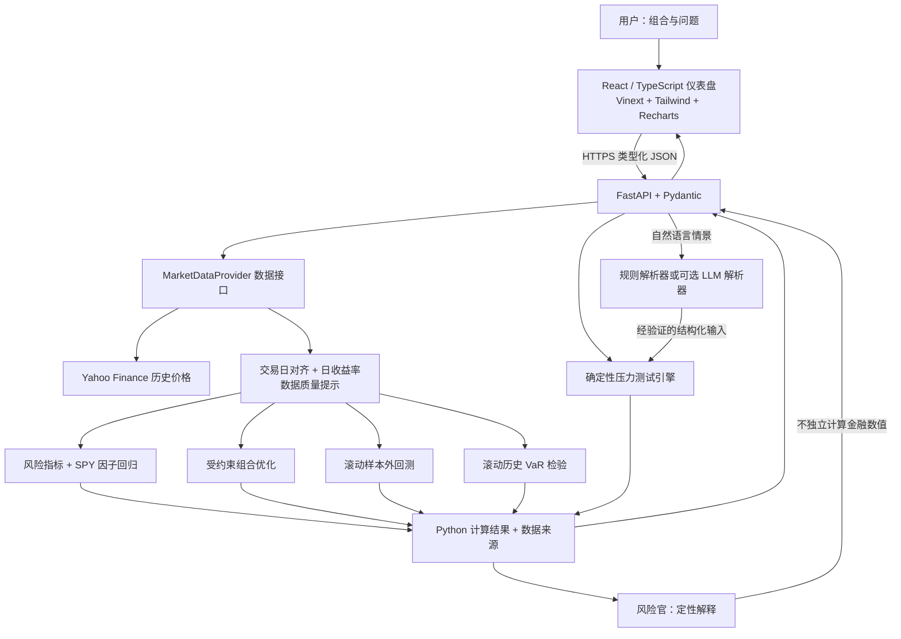
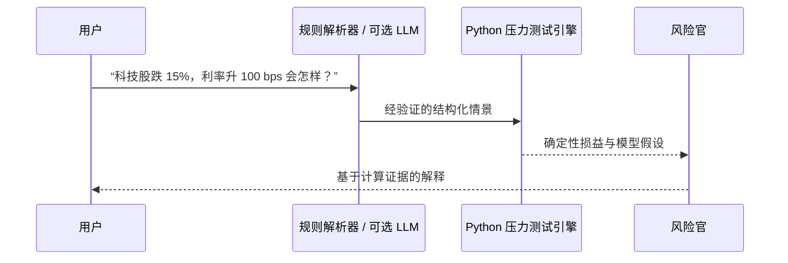
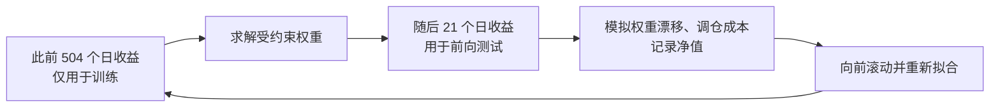

# RiskLens — AI 投资组合风险终端

[](https://github.com/TianLu-hub/RiskLens/actions/workflows/ci.yml)

[English](README.md) · **简体中文**

[在线演示](https://risklens-ai-portfolio-risk-terminal.tianlu923.chatgpt.site/) · [后端健康检查](https://balanced-intuition-production-6020.up.railway.app/health)

RiskLens 是面向股票与 ETF 投资组合的全栈风险分析项目。用户输入股票代码和权重后，可以查看历史风险指标、运行明确标注为假设性的压力测试、比较受约束的优化权重，并通过按时间顺序滚动的样本外回测检验方法。项目用于量化金融学习与展示，**不是交易系统，也不提供个性化投资建议**。

> **数值边界：** 所有金融指标和情景损益都由确定性的 Python 代码计算。默认的“AI 风险官”是免费的规则解释层；可选的服务端 LLM 只负责理解语言及解释已提供的结果，不会虚构或自行计算数值。

## 功能概览

点击页头的 **EN / 中文** 可切换英文和简体中文界面，浏览器会记住你的选择。切换语言不会重置输入或改变计算结果；尚未收录翻译的后端说明保留原文，金额单位仍为美元。

点击指标旁的 ⓘ，可按当前语言查看定义、公式、阅读方式和局限。说明覆盖 VaR、CVaR、SPY Beta、波动率风险贡献等九项指标，与 Python 实现口径对应，不调用 AI 服务。

| 模块 | 已实现功能 |
| --- | --- |
| 组合风险 | 几何年化收益、波动率、Sharpe 估计、历史单日 VaR/CVaR、回撤、相关性、Euler 波动率风险贡献、集中度和规则风险提示。 |
| 压力测试 | 市场、科技、利率和单一股票冲击；简化的历史风格预设；资产及风险因子损益归因；明确披露久期与行业暴露的兜底假设。 |
| 风险官 | 对有限范围的中英文情景表达进行解析，并基于计算结果解释风险；可选 OpenAI Structured Outputs 模式默认关闭。 |
| 因子暴露 | 以 SPY 为市场代理的历史回归：beta、alpha、R²、残差波动率及 60 日滚动 beta；不伪造 SMB/HML。 |
| 组合优化 | 仅做多的最小波动率、最大 Sharpe、风险平价，可设置单一持仓上限；不会自动改动用户组合。 |
| 滚动回测 | 用过去数据拟合、在后续日期测试；模拟权重漂移、月度调仓、可配置交易成本，并与固定目标权重组合比较。 |
| VaR 检验 | 用此前的滚动窗口估计单日历史 VaR，与下一日实际观测损失比较；报告突破次数、比例及逐日预测记录。 |

默认组合：**AAPL 20% · MSFT 20% · NVDA 15% · SPY 25% · TLT 20%**。

持仓编辑、回看年限和无风险利率会保存在当前浏览器，刷新后自动恢复。分析结果不会保存，需点击 **Analyze portfolio** 重新获取历史行情。修改输入后会提示更新分析，风险官会等待新分析完成后再解释当前组合。保存记录仅属于当前设备和浏览器；浏览器存储不可用时仍可运行分析。

## 系统架构



自然语言压力测试的计算边界如下：



### 滚动样本外回测



每一轮的训练期都在测试期**之前**结束，不会用该轮未来收益求权重。默认向 Yahoo Finance 请求约三年的历史数据：首个训练窗口为 504 个对齐的日收益（约两个交易年），此后约每 21 个交易日重新训练和测试。数据请求缓存 15 分钟；API 会返回实际对齐后的起止日期和观测数量。这里使用的是**历史日数据，不是交易所实时行情**。

**示例结果，并非业绩承诺：** 使用截至 2026-10-14 可取得的数据，默认组合的最小波动率滚动测试覆盖 2025-10-10 至 2026-10-13（253 个前向交易日、13 个窗口）。在模型设定的 10 bps 交易成本下，优化策略的模拟累计收益为 **−0.94%**，固定原目标权重组合为 **+14.06%**。即使优化策略落后，也如实报告；结果会随数据、输入和假设而变化。

### 滚动历史 VaR 检验

对每个测试日 `t`，仅使用此前 `window_days` 个对齐后的组合日收益，即切片 `[t − window_days:t]`，以线性插值计算单日 `VaR_t = −quantile(returns, 1 − confidence_level)`。训练窗口在 `t` 之前结束，不包含当天或之后的收益。只有 `−r_p,t > VaR_t` 时才记为突破；相等不算突破，负的 VaR 阈值会原样保留，不截为零。当前组合权重保持固定，假设每日恢复目标权重且不计交易成本。这是基于历史数据的假设性检验，不代表实际交易，也不保证未来的风险覆盖能力。

默认训练窗口为 252 个日收益（可选范围为 60–1260），其后至少需要 20 个样本外日收益。`data_quality.observations`、`start_date` 和 `end_date` 描述包含训练期在内的全部对齐收益样本；`test_observations`、`test_start` 和 `test_end` 仅描述接受检验的预测日。逐日记录包含训练起止日期、带符号的 VaR 阈值、观测收益／损失及突破标记。数据源元数据原样传递。

名义预期突破比例为 `1 − confidence_level`，预期次数为该比例乘以测试观测数。测试少于 252 天或预期突破次数低于 5 时会给出提示。样本较少、尾部分位精度有限、训练窗口重叠以及收益序列相关性都会限制结果的解释范围。次数和比例仅作描述；本版本尚不提供 Kupiec 检验、统计显著性结果或通过／不通过判定。

## 主要量化定义

设对齐后的资产日收益为 `r_t`，组合权重为 `w`，年化协方差为 `Sigma_ann = 252 × Cov(r)`：

| 指标 | 定义 |
| --- | --- |
| 组合日收益 | `r_p,t = wᵀ r_t` |
| 几何年化收益 | `R_ann = [逐日连乘 (1 + r_p,t)]^(252/T) − 1` |
| 年化波动率 | `sigma_p = sqrt(wᵀ Sigma_ann w)` |
| Sharpe 估计 | `(R_ann − R_f) / sigma_p` |
| 历史 95% 单日 VaR / CVaR | 负的 5% 分位收益 / 该分位以下收益的负均值，按损失口径展示，保留可能为负的数值。 |
| 最大回撤 | `V_t / max(V_s，s ≤ t) − 1` 的最小值；初始净值也计入历史高点。 |
| 波动率风险贡献比例 | `w_i (Sigma_ann w)_i / (wᵀ Sigma_ann w)`，比例之和约为 1。 |
| 有效持仓数 | `1 / sum_i(w_i²)` |
| 债券利率冲击 | 一阶近似 `ΔP/P ≈ −D × Δy`；兜底久期会明确标注。 |
| 单边换手率 | `0.5 × sum_i(abs(w_i,new − w_i,pretrade))`；模型对其两倍的总交易名义金额收取成本。 |

优化使用 SciPy SLSQP，并约束 `sum_i(w_i) = 1`、`w_i ≥ 0`，可选 `w_i ≤ w_max`。最大 Sharpe 使用与界面一致的几何收益估计；风险平价以风险贡献比例相等为目标。非线性目标从多个固定初值求解，**不保证全局最优**。

## 代码结构

```text
backend/
  app/api/             风险分析、压力测试、风险官、优化、回测及 VaR 检验 API
  app/models/          Pydantic 输入输出模型
  app/data/            可替换的 Yahoo Finance 数据接口
  app/risk/            确定性风险、因子、压力测试及滚动 VaR 检验模块
  app/optimization/    优化器与滚动回测模拟
  app/ai/              有边界的解析器与可选 LLM 适配器
  tests/               合成数据单元测试与 API 测试
frontend/
  app/                 页面入口和主题
  components/          仪表盘模块与通用 UI
  lib/                 类型化 API 客户端与明确标注的演示快照
docs/                   简历要点和项目论文
docker-compose.yml
```

## 本地运行

需要 Python 3.12+、Node.js 22.13+ 和 pnpm。在项目根目录分别打开两个终端。

**终端 1 — FastAPI**

```bash
cd backend
python3 -m venv .venv
source .venv/bin/activate
pip install -r requirements.txt
cp .env.example .env
uvicorn app.main:app --host 127.0.0.1 --port 8000 --reload --env-file .env
```

**终端 2 — 前端**

```bash
cd frontend
cp .env.example .env.development.local
pnpm install
pnpm dev
```

打开 `http://localhost:3000`。后端健康检查：`http://127.0.0.1:8000/health`；交互式 API 文档：`http://127.0.0.1:8000/docs`。本地前端指向 `http://localhost:8000`。默认的确定性模式**不需要 OpenAI API Key**。后端不可用时，预置分析会明确显示为合成数据演示快照。

也可以在项目根目录运行 `docker compose up --build`；前端和 API 分别使用 3000、8000 端口。

## API 与部署

| 接口 | 用途 |
| --- | --- |
| `POST /portfolio/analyze` | 历史组合风险与数据质量。 |
| `POST /portfolio/stress-test` | 假设性冲击与损益归因。 |
| `POST /portfolio/optimize` | 样本内优化对比。 |
| `POST /portfolio/backtest` | 按时间顺序的滚动回测。 |
| `POST /portfolio/var-backtest` | 对单日历史 VaR 进行滚动样本外检验。 |
| `POST /ai/risk-officer` | 风险解释或情景翻译。 |
| `GET /market/history/{ticker}` | 标准化价格历史。 |
| `GET /health` | 服务状态与版本。 |

`/portfolio/backtest` 请求示例：

```json
{
  "positions": [
    {"ticker": "AAPL", "weight": 0.20},
    {"ticker": "MSFT", "weight": 0.20},
    {"ticker": "NVDA", "weight": 0.15},
    {"ticker": "SPY", "weight": 0.25},
    {"ticker": "TLT", "weight": 0.20}
  ],
  "lookback_years": 3,
  "risk_free_rate": 0.04,
  "objective": "minimum_volatility",
  "max_position_weight": null,
  "training_days": 504,
  "rebalance_days": 21,
  "cost_bps": 10
}
```

`/portfolio/var-backtest` 请求示例：

```json
{
  "positions": [{"ticker": "SPY", "weight": 1.0}],
  "lookback_years": 3,
  "window_days": 252,
  "confidence_level": 0.95
}
```

该请求沿用 `/portfolio/analyze` 的组合输入校验。继承的 `risk_free_rate` 参数可以传入，但不参与计算，因为历史 VaR 使用组合原始收益。

当前前端部署在 OpenAI Sites，FastAPI 后端部署在 Railway。换平台部署时，前端 `NEXT_PUBLIC_API_URL` 应填**公开的 HTTPS 后端地址**，不可填 localhost；后端 `CORS_ORIGINS` 应填准确的前端来源。若启用可选 LLM，`OPENAI_API_KEY` 只能配置在后端。本版本没有用户账户和云端保存组合。

### 上线后检查

安装后端依赖后，在 `backend/` 目录运行：

```bash
# 检查本地 API 与浏览器来源，不调用 Yahoo 或 LLM
python -m scripts.check_deployment

# 检查线上 API，并主动验证历史行情请求
python -m scripts.check_deployment \
  --api-url https://balanced-intuition-production-6020.up.railway.app \
  --origin https://risklens-ai-portfolio-risk-terminal.tianlu923.chatgpt.site \
  --include-market-data --timeout 60
```

工具验证 RiskLens 健康响应、浏览器 CORS 预检、实际响应的跨域头，以及假设压力测试的响应结构。加上 `--include-market-data` 后，还会将默认组合提交到 `/portfolio/analyze`，可能命中缓存或获取 Yahoo 历史数据。不调用 AI、不保存组合、不修改部署设置。

退出码 `0` 表示所选检查通过，`1` 表示某项检查失败，`2` 表示命令参数错误。连接失败时检查 API 地址、TLS、超时和服务状态；跨域失败时检查后端 `CORS_ORIGINS`。即使 `/health` 正常，行情分析仍可能因数据源不可用而返回 `503`。重定向和 HTML 登录页不算健康 API。本工具检查连通性和响应结构，不替代量化正确性审计、行情新鲜度核验或浏览器界面测试。

## 数据来源与样本

历史行情缓存保存在各后端进程内，有效期为 15 分钟，默认最多保留 128 个组合／日期区间条目。请求时清理过期条目；容量满后淘汰最久未使用的条目。缓存命中不延长原有效期。条目上限限制的是保留的历史快照，不等于进程总内存或并发下载上限。

中英文数据面板区分历史日度行情、合成演示数据和假设模型结果。分析、优化、组合回测及 VaR 检验响应包含可选的 `data_quality.provenance`，记录数据源获取时间（UTC）、缓存命中及有效期、价格口径、对齐后的价格日期和逐资产覆盖信息。缓存命中保留最初获取时间，不代表新报价。旧后端未提供元数据时显示“未提供”，不编造时间。

实际样本数量指**日收益观测数**，不是价格行数，也不等于请求年数。回测样本包含训练和测试数据，样本外测试天数另行显示。缺失统计仅基于数据源返回的日期，不是完整交易日历核验。短缺口最多前向填充三行，仍不完整的日期被剔除；界面披露保留样本的填充数量及各资产最后有效价格日期。本次不改变计算公式或现有对齐规则。

## 测试

```bash
cd backend
.venv/bin/pytest -q
.venv/bin/ruff check app scripts tests

cd ../frontend
pnpm lint
pnpm test
pnpm build
```

后端测试使用确定性的合成价格数据，不依赖 Yahoo Finance 或 LLM 账户。部署检查工具的测试同样使用进程内 API 和模拟网络。当前测试结果以 CI 为准；上线后可用上述可选检查单独验证真实行情链路。

## 局限性与后续方向

- 历史 VaR/CVaR、beta 和拟合权重描述的是选定样本，不能预测未来损失或收益。
- 优化面板是样本内对比；独立的滚动回测面板只是按时间顺序进行的**假设性模拟**，并非实际成交记录。今天选定的股票可能带有事后选择偏差。
- 模拟的收盘价执行与固定 bps 成本未覆盖买卖价差、滑点、市场冲击、税费及幸存者偏差修正。
- 历史风格压力测试只是简化的线性冲击，不能精确重现真实事件。科技暴露和债券久期均为已披露的兜底假设，而非实时持仓数据或实时测量值。
- 因子模型目前仅以 SPY 为市场代理；SMB、HML、动量等因子须接入可靠数据后才能展示。
- Yahoo Finance 数据可能延迟、修订、缺失或暂时不可用；系统会对齐日期、给出警告，并在只能使用未调整收盘价时披露降级。
- 后续研究可加入成交延迟与滑点敏感性、更可靠的因子数据，以及跨训练窗口和市场环境的稳健性检验。只有需要保存组合时才有必要增加持久化。

**仅供教育和研究使用，不构成个性化投资建议。**
